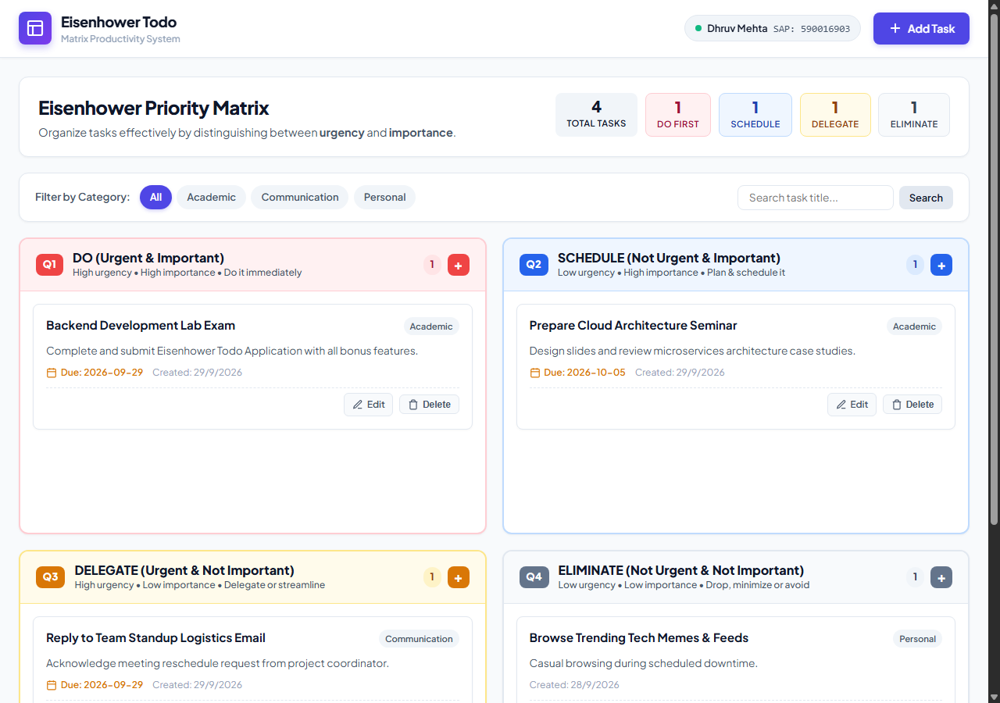
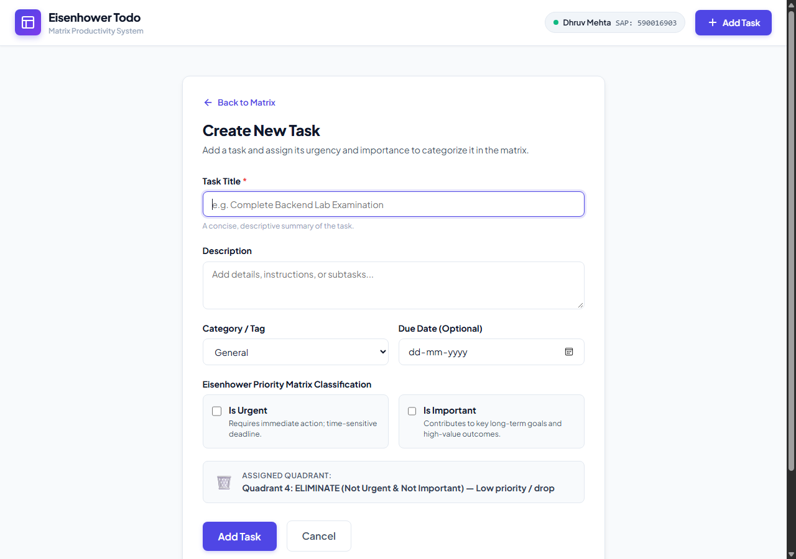

# Backend Development Lab Examination: "Eisenhower Todo" Application

**Course:** Backend Development  
**Student Name:** Dhruv Mehta  
**SAP ID:** 590016903  
**Examination Set:** Exam 01 B  
**Technology Stack:** Node.js with Express.js, EJS Template Engine, MongoDB (`mongodb` driver)  

---

## 📌 Project Overview
**Eisenhower Todo** is a full-featured, server-side rendered Task Management Web Application developed according to the specifications of the UPES SOCS **Backend Development Lab Examination (Exam 01 B)**. 

The application enables users to add, view, organize, edit, and delete tasks categorized dynamically into the **4-quadrant Eisenhower Matrix** based on **Urgency** and **Importance**.

---

## 🎯 Compulsory Requirements Implemented

### 1. Display Tasks (4-Quadrant Eisenhower Matrix)
- **Home Route (`GET /tasks` or `GET /`)**:
  - Retrieves all tasks from MongoDB and dynamically segregates them into four distinct quadrants based on the boolean flags `isUrgent` and `isImportant`:
    1. **Q1: DO (Urgent & Important)**: Tasks that are both urgent and important (requires immediate action).
    2. **Q2: SCHEDULE (Not Urgent & Important)**: High-importance, long-term strategic tasks (plan & schedule).
    3. **Q3: DELEGATE (Urgent & Not Important)**: Urgent tasks that can be delegated or streamlined.
    4. **Q4: ELIMINATE (Not Urgent & Not Important)**: Low-urgency, low-importance activities to minimize or drop.
  - Each task entry clearly shows:
    - **Title**
    - **Description**
    - **Category badge**
    - **Due date** (if specified)
    - **Creation date**
    - **Edit button**
    - **Delete button** with confirmation dialog.
  - Quadrants display real-time counters and clean empty-state placeholders when no tasks exist.

### 2. Add Task Form & Validation
- **Form Route (`GET /tasks/new`)**:
  - Clean HTML form containing:
    - **Title** (`<input type="text">`, required)
    - **Description** (`<textarea>`)
    - **Checkbox: Is Urgent** (`isUrgent`)
    - **Checkbox: Is Important** (`isImportant`)
    - **Category / Tag dropdown**
    - **Due Date picker**
    - **Live Dynamic Matrix Preview Banner**: Real-time JavaScript preview showing which quadrant the task will land in as checkboxes are toggled.
- **Submission Route (`POST /tasks`)**:
  - **Server-side validation**: Validates that `title` is not empty or pure whitespace. Returns HTTP 400 with an informative error message if invalid.
  - Checkbox parsing: Correctly converts HTML checkbox values (`'on'` / omitted) into boolean values (`true` / `false`).
  - Inserts document into MongoDB `todo_lab` database under the `tasks` collection.
  - Redirects to `/tasks` upon successful insertion.

### 3. Delete Task Operation
- **Route (`POST /tasks/:id/delete`)**:
  - Deletes the task from MongoDB matching the specified `ObjectId`.
  - Redirects back to `/tasks`.

### 4. Server-Side Rendering (EJS)
- Built using modular EJS templates:
  - `views/partials/header.ejs`: Responsive navigation, branding, student badge.
  - `views/partials/footer.ejs`: Examination and student metadata.
  - `views/index.ejs`: 4-quadrant Eisenhower Matrix layout.
  - `views/new.ejs`: Add Task form.
  - `views/edit.ejs`: Edit Task form.

---

## 🌟 Bonus Features Implemented (Up to 3 Bonus Marks)

1. **Edit Existing Tasks**:
   - `GET /tasks/:id/edit`: Retrieves task by ID and renders pre-populated form.
   - `POST /tasks/:id/edit`: Validates and updates the document in MongoDB.
2. **Filter Tasks by Category / Tag**:
   - Category chips on dashboard allow filtering tasks by `Academic`, `Work`, `Personal`, `Communication`, or `General`.
   - Title search functionality (`GET /tasks?search=keyword`).
3. **Advanced CSS Grid & Flexbox Matrix Layout**:
   - Responsive 2x2 grid layout using CSS Grid and Flexbox with dedicated color themes for each quadrant:
     - **Q1 (DO)**: Coral / Crimson Red (`#ef4444`)
     - **Q2 (SCHEDULE)**: Cobalt Blue (`#2563eb`)
     - **Q3 (DELEGATE)**: Amber / Gold (`#d97706`)
     - **Q4 (ELIMINATE)**: Slate / Gray (`#64748b`)
4. **Due Date Support**:
   - Optional due date field with badge indicator on task cards.

---

## 🗄️ MongoDB Information & Document Structure

- **Connection URL:** `mongodb://127.0.0.1:27017`
- **Database Name:** `todo_lab`
- **Collection Name:** `tasks`

### Document Structure:
```json
{
  "_id": "673f8a1234567890abcdef12",
  "title": "Backend Development Lab Exam",
  "description": "Complete and submit Eisenhower Todo Application with all bonus features.",
  "isUrgent": true,
  "isImportant": true,
  "category": "Academic",
  "dueDate": "2026-09-29",
  "createdAt": "2026-09-29T05:45:00.000Z"
}
```

> **Note on Portability / Dev Fallback:**  
> The application uses the official MongoDB driver with a single persistent `MongoClient`. If the local MongoDB daemon is temporarily inactive during testing outside the lab network, the server automatically uses an intelligent in-memory MongoDB fallback with pre-seeded tasks so the application never crashes and can be tested anywhere. When MongoDB is running at `mongodb://127.0.0.1:27017`, it connects immediately and persists all data.

---

## 🚀 Execution Instructions (How to Run in VS Code)

### Prerequisites
- Node.js (v18+)
- MongoDB server (running at `mongodb://127.0.0.1:27017`)
- VS Code or modern web browser

### Step 1: Open Terminal in Project Directory
Navigate to the project folder:
```bash
cd lab/Exam_01
```

### Step 2: Install Dependencies
```bash
npm install
```
*(Dependencies: `express`, `ejs`, `mongodb`, `dotenv`)*

### Step 3: Run the Application
```bash
npm start
```
*Or for live development:*
```bash
npm run dev
```

### Step 4: Open in Web Browser
Navigate to:
👉 **[http://localhost:3000](http://localhost:3000)**

---

## 🧪 Automated Testing
To run the automated test suite verifying all 28 requirements, CRUD operations, and Eisenhower quadrant routing:
```bash
npm test
```

---

## 📋 Route Reference Table

| Method | Route | Description |
| :--- | :--- | :--- |
| `GET` | `/` | Redirects to `/tasks` |
| `GET` | `/tasks` | Displays 4-quadrant Eisenhower Matrix (supports `?category=` and `?search=`) |
| `GET` | `/tasks/new` | Displays Add Task form |
| `POST` | `/tasks` | Validates and inserts new task into MongoDB |
| `POST` | `/tasks/:id/delete` | Deletes task by MongoDB `_id` |
| `GET` | `/tasks/:id/edit` | Displays Edit form for existing task (Bonus) |
| `POST` | `/tasks/:id/edit` | Updates existing task in MongoDB (Bonus) |
| `GET` | `/tasks/seed` | Development route to seed sample tasks across all quadrants |

---

## 📸 Application Screenshots

### 1. Eisenhower Matrix 4-Quadrant Dashboard:


### 2. Add Task Form with Real-Time Matrix Preview:

